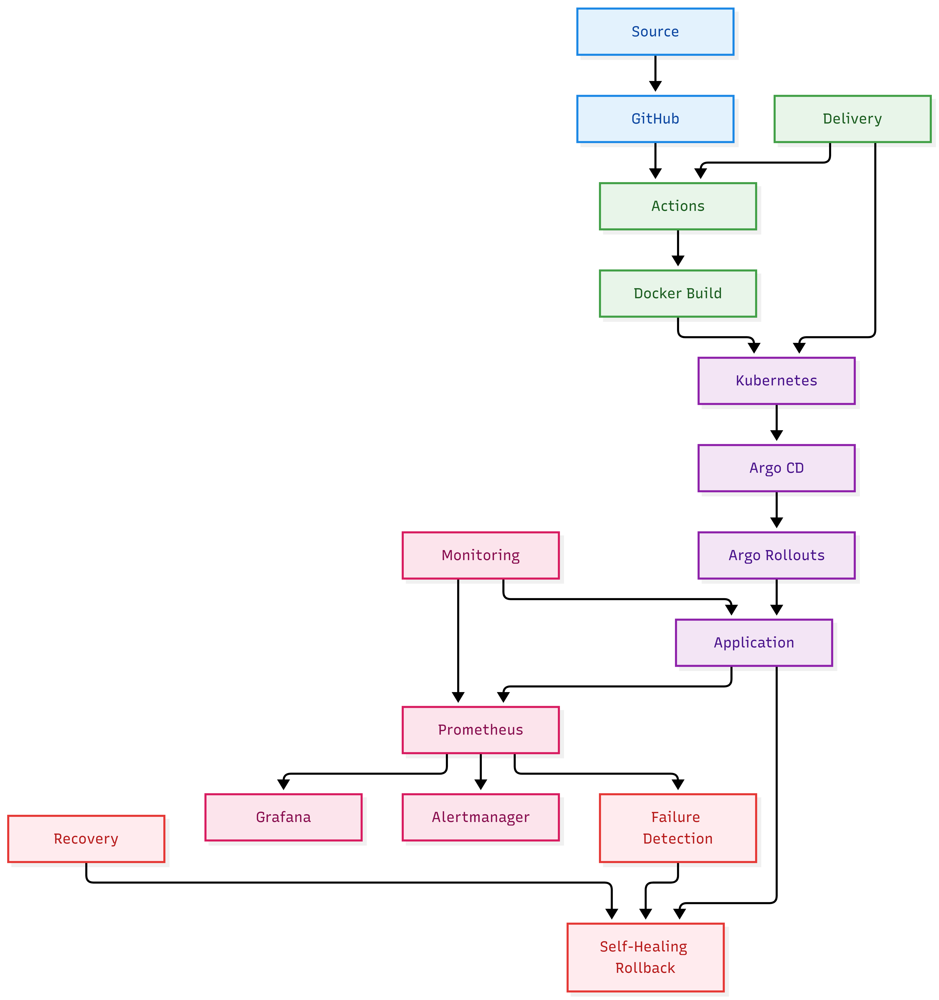
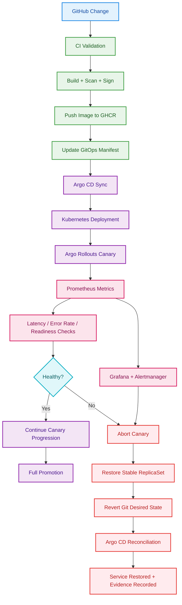

# SentinelDeploy

A Secure, Observable, Self-Healing Application Delivery Platform

SentinelDeploy is a production-style DevOps and SRE portfolio project designed to demonstrate how a modern delivery pipeline can detect bad releases, stop failed deployments before full promotion, restore the last known-good version, and record the recovery evidence.

The project combines:
- GitHub Actions for CI/CD
- Docker for containerization
- k3d for local Kubernetes testing
- Kubernetes for workloads
- Prometheus for signal collection
- Argo CD and Argo Rollouts for GitOps and progressive delivery
- Terraform and Ansible for AWS infrastructure automation
- DevSecOps controls such as Gitleaks, Trivy, Syft, Cosign, and secure container practices

The focus is not just deploying containers. The goal is to implement application-aware release recovery, so a faulty release can be detected, aborted, and rolled back automatically while preserving service availability.

---

## Why this project exists

Traditional CI/CD pipelines can build and deploy software successfully while still introducing production failures. For example:

- API error rates spike after release
- latency increases unexpectedly
- pods become unhealthy but continue to run
- a bad version is re-applied by GitOps reconciliation
- the deployment looks successful but the application is actually degraded

SentinelDeploy addresses that by combining:
- automated checks in CI
- immutable image references
- canary-based rollout evaluation
- Prometheus-based health analysis
- rollout aborts on bad signals
- restoration of the last known-good version
- Git desired-state correction to avoid reintroducing the bad image
- incident evidence collection

---

## Core platform goals

1. Receive application changes from GitHub
2. Run automated tests
3. Run security scanning
4. Build and verify container images
5. Generate SBOMs
6. Sign the image
7. Publish the image to GHCR
8. Sync deployment state via GitOps
9. Use Argo CD to reconcile desired state
10. Use Argo Rollouts for progressive canary delivery
11. Evaluate health with Prometheus
12. Abort unhealthy releases automatically
13. Restore last known-good version
14. Fix the GitOps desired state so the failed image is not re-applied
15. Record evidence and alerts for incidents

---

## Architecture overview



## Release and Recovery Flow



```text
Developer
  |
  v
GitHub Repository
  |
  v
GitHub Actions
  |--> Unit tests
  |--> Integration tests
  |--> Secret scanning
  |--> Dependency scanning
  |--> Build image
  |--> Trivy scan
  |--> SBOM generation
  |--> Image signing
  v
GHCR (container registry)
  |
  v
GitOps deployment manifests
  |
  v
Argo CD
  |
  v
Kubernetes cluster
  |
  v
Argo Rollouts
  |--> 10% canary
  |--> 25% canary
  |--> 50% canary
  |--> full promotion
  |
  v
Application API
  |
  v
Prometheus
  |--> error rate
  |--> latency
  |--> success rate
  |--> readiness
  v
Analysis / abort / rollback
  |
  v
Incident evidence + alerts
```

---

## Technology stack

### Application layer
- Node.js
- Express
- Prometheus client
- Jest

### Containerization
- Docker
- Docker Compose

### Kubernetes
- k3d for local cluster
- k3s for AWS lab deployment
- Kubernetes Deployments and Services
- readiness and liveness probes

### GitOps and progressive delivery
- Argo CD
- Argo Rollouts

### CI/CD and security
- GitHub Actions
- Gitleaks
- Trivy
- Syft
- Cosign
- GitHub Container Registry (GHCR)

### AWS infrastructure
- Terraform
- Ansible
- EC2
- VPC
- security groups
- IAM with OIDC principles

### Observability
- Prometheus
- Grafana
- Alertmanager
- Kubernetes events
- structured application logs

---

## Application behavior

The sample application is a small Node.js API with these endpoints:

- `/` — basic app metadata
- `/healthz` — liveness endpoint
- `/readyz` — readiness endpoint
- `/metrics` — Prometheus metrics
- `/api/orders` — simulated business endpoint
- `/admin/failure-mode` — controlled test-only failure injection

The application includes:
- application version reporting
- request counters
- HTTP error counters
- latency histograms
- status reporting
- controlled failure modes for test and canary evaluation

Failure injection is intentionally disabled by default, and it is never meant to be enabled in production-like environments without access control.

The supported failure modes include:
- `normal`
- `high-error-rate`
- `high-latency`
- `readiness-failure`
- `crash-loop`
- `dependency-failure`
- `memory-pressure`

---

## Repository structure

```text
sentineldeploy/
├── app/
│   ├── src/
│   ├── tests/
│   ├── Dockerfile
│   ├── README.md
│   └── package.json
├── .github/
│   └── workflows/
│       ├── ci.yml
│       ├── security-scan.yml
│       └── release.yml
├── kubernetes/
│   └── base/
│       ├── namespace.yaml
│       ├── deployment.yaml
│       └── service.yaml
├── infrastructure/
│   ├── terraform/
│   └── ansible/
├── gitops/
│   └── argocd/
├── progressive-delivery/
│   ├── analysis-templates/
│   ├── rollout-policies/
│   └── rollback-workflows/
├── observability/
│   ├── prometheus/
│   ├── alertmanager/
│   └── grafana/
├── security/
│   ├── trivy/
│   ├── cosign/
│   ├── kyverno/
│   └── sops/
├── testing/
│   ├── failure-injection/
│   ├── integration/
│   ├── load/
│   └── recovery/
├── scripts/
├── docs/
├── docker-compose.yml
├── .gitignore
├── package.json
├── package-lock.json
├── README.md
└── LICENSE
```

---

## Milestones

### M1 — Application and Containers
Completed goals:
- initialize repository
- create Node.js API
- expose health and metrics endpoints
- add unit tests
- add controlled failure injection
- containerize the app
- validate Docker runtime behavior

### M2 — Local Kubernetes
Completed goals:
- install and configure k3d
- create a local cluster
- deploy the app into Kubernetes
- configure probes and resource requests
- validate pod self-healing and recovery

### M3 — CI and DevSecOps
Implemented goals:
- GitHub Actions CI workflow
- security scanning with Trivy
- secret scanning with Gitleaks
- image build validation
- container smoke testing

### M4 — GitOps
Planned next step:
- install Argo CD
- configure app synchronization
- enforce Git-driven deployment reconciliation
- ensure desired state is corrected on rollback

### M5 — Progressive Delivery
Planned next step:
- configure Argo Rollouts
- define canary stages
- integrate Prometheus analysis
- validate abort and recovery behavior

### M6 — Self-Healing and Incident Evidence
Planned next step:
- automated rollback logic
- Git desired-state restoration
- Alertmanager alerts
- incident report generation

### M7 — AWS Deployment
Planned next step:
- Terraform for EC2 and networking
- Ansible for host configuration
- remote deployment from a small AWS environment

### M8 — Validation and Portfolio Packaging
Planned final step:
- full failure scenario validation
- dashboards and operational reporting
- readme and runbook completion
- final portfolio presentation

---

## Local development setup

### Prerequisites

Install:
- Git
- Node.js 22+
- npm
- Docker Desktop or Docker Engine
- kubectl
- k3d

### Clone the repo

```bash
git clone https://github.com/SyedMuqeem03/sentineldeploy.git
cd sentineldeploy
```

### Install dependencies

```bash
npm install
```

### Run tests

```bash
npm test
```

### Run the app locally

```bash
node app/src/app.js
```

### Run with Docker Compose

```bash
docker compose up --build -d
```

Then verify:

```bash
curl http://localhost:3000/healthz
curl http://localhost:3000/metrics
```

### Create local Kubernetes cluster

```bash
k3d cluster create sentinel-dev --servers 1 --agents 1 --port '8081:80@loadbalancer'
```

### Import the app image into k3d

```bash
k3d image import self-healingdeploymentplatform-sentineldeploy:latest -c sentinel-dev
kubectl apply -f kubernetes/base/namespace.yaml
kubectl apply -f kubernetes/base/deployment.yaml
kubectl apply -f kubernetes/base/service.yaml
```

### Verify app health in k3d

```bash
kubectl -n sentineldeploy get pods
kubectl -n sentineldeploy port-forward svc/sentineldeploy-api 8080:80
curl http://localhost:8080/healthz
```

---

## Security and engineering practices

This project follows a secure-default posture:

- non-root container execution
- read-only filesystem where practical
- dropped Linux capabilities
- resource requests and limits
- container health probes
- GitHub Actions OIDC-based AWS access in the future
- immutable image references
- security scanning before release
- SBOM generation for every release
- image signing with Cosign
- least-privilege principles
- no secrets committed to Git

---

## Failure scenarios covered

The project is designed to exercise and document failure patterns such as:

- normal release promotion
- HTTP 500 spike during canary
- latency regression
- readiness failures
- crash-loop conditions
- Prometheus signal loss
- missing image in registry
- invalid image signature rejection
- Argo CD reconciling against stale state
- Git desired-state recovery

The core objective is to prove that a failed canary can be aborted and the last known-good state restored without leaving the application degraded.

---

## Current status

This repository is in active development with Milestone 1 and Milestone 2 validated locally.

Current verified status:
- Node.js application and tests pass
- Docker image builds and runs
- health and metrics endpoints are working
- Kubernetes cluster deployment is working
- pod self-healing after restart is working
- GitHub Actions security workflow is operational

Next focus areas:
- complete the CI workflow validation on GitHub
- integrate Argo CD
- add Argo Rollouts canary analysis
- implement automated rollback and GitOps recovery
- add AWS infrastructure automation

---

## Why this matters for interviews

SentinelDeploy demonstrates more than basic deployment knowledge. It shows:
- platform thinking
- operational awareness
- GitOps fundamentals
- progressive delivery patterns
- release safety engineering
- observability-driven rollback
- incident response discipline
- secure DevSecOps implementation

This is a strong portfolio project because it combines software delivery, infrastructure, security, observability, and automated recovery in a realistic end-to-end workflow.

---

## Contributing

This project is intended to be used as a portfolio and learning platform. Contributions and suggestions are welcome in the form of issues, pull requests, or improvements to reliability and automation.

---

## License

This project is intended for learning and portfolio demonstration purposes. Add an appropriate license before public release if required by your workflow.
